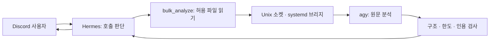

# Agent History

**LLM 중계의 데이터 변형을 줄이기 위해, 원문 전달과 결과 검증을 코드로 옮긴 개인 에이전트 운영 프로젝트.**

> *A personal agent-ops project that moved source delivery and result verification out of an LLM relay and into code: a sandboxed Unix-socket bridge that lets Hermes delegate document analysis to agy and checks every returned quotation against the source.*



- **만든 것:** Hermes가 agy에 분석을 위임하는 로컬 브리지와 플러그인. 기존 독립 agy Discord 봇과 함께 운영한다.
- **핵심 설계:** 경로별 파일 열기, 소켓 peer UID 확인, systemd 제한, 출력·정리 시간 제한, 구조화 결과 검사.
- **확인한 결과:** 5,807바이트 프로젝트 문서 1건의 Discord 정상 분석 경로, 도구 반환과 최종 저장 답변의 인용 14개 보존, Linux Python 3.12.3 fake 시험 31개 통과.

## 왜 만들었나

초기에는 Hermes의 중계 모델이 `!pro`를 명령으로 분기하기보다 의미를 분석하거나, Gemini Pro의 응답을 새 사용자 지시처럼 다시 처리하는 경우가 있었다. 두 모델 사이의 컨텍스트 차이도 중계의 제약이었다. 사용자 경험을 바탕으로 환경을 초기화하고 **프롬프트 중계 → 독립 봇 → 코드 기반 위임**으로 구조를 바꿨다.

이 저장소는 그 설계 판단과 실패 수정의 기록이다. 개인 운영 메모와 기술 포트폴리오를 함께 목적으로 하며 범용 설치 배포판은 아니다.

## 먼저 볼 문서

| 관심사 | 문서 |
|---|---|
| 보안 설계 | [위협 모델](docs/10-threat-model.md) · [systemd·설정 예시](examples/README.md) |
| 실패에서 배운 것 | [157KB 실패와 도구 시도](docs/03-incidents.md#incident-large-input) · [반환 계약 오류](docs/03-incidents.md#incident-result-contract) |
| 직접 내린 판단 | [결정 기록](docs/08-decisions.md) · [연대기](docs/01-history.md) |
| 근거와 신뢰 범위 | [검증 현황](docs/04-validation.md) · [출처·AI 협업](docs/06-provenance.md) |
| 다음 작업·운영 | [다음 시험](docs/05-next-validation.md) · [교재 수집 계획](docs/13-drive-material-collection-plan.md) · [강의 의미 평가 준비](docs/12-lecture-semantic-review-20261011.md) · [운영 메모](docs/09-operations.md) |

[상세 구조](docs/02-architecture.md) · [공개 기록 원칙](docs/07-publication.md) · [NOTICE](NOTICE.md)

## 검증 경계

**2026-10-11 기준:** 프로젝트 문서 시험은 첫 시도에서 근거 개수 초과로 실패했고, 프롬프트 보강 후 두 번째 시도에서 성공했다. 저장 결과와 실제 도구 반환이 일치하고, 최종 저장 답변의 인용 14개가 보존됐다. Discord 전달은 사용자 제공 메시지로 확인했다. 세부 주장과 선택된 근거의 연결에 개선점 1건이 있어 의미적 품질 전체를 승인하지 않는다. [시험 기록](docs/11-validation-20261011.md) 참조.

과거 16KB 합성 입력 성공과 157KB 실패는 기존 판정을 유지한다. 대표 강의 문서 품질·장문 처리·반복 안정성·재부팅 복구는 아직 미검증이다.

인용 일치가 의미적 정확성을 보증하지 않으며, 도구 감지는 관측 후 중단이다. 완전한 격리·프롬프트 인젝션 방어·비용 절감을 입증한 프로젝트로 소개하지 않는다. 용어와 성공 기준은 [검증 경계 정의](docs/04-validation.md#verification-boundaries)에 모았다.

## 코드 확인

`bridge/`는 schema-r3, JSON 문자열 반환 수정 및 2026-10-11 프롬프트 한도 명시를 포함한다. 서버에서 전체 소스를 새로 수집한 스냅샷은 아니며, 독립 Discord 봇·Hermes 본체·agy 바이너리는 포함하지 않는다.

**Python 3.11 이상.** 아래 명령은 모델 호출과 서비스 변경 없이 실행한다.

```bash
cd bridge
python -m unittest -v test_bridge.Validation test_result_contract
```

Linux 임시 환경에서 fake 프로세스·Unix 소켓 시험까지 수행하려면:

```bash
cd bridge
python -m unittest -v test_bridge test_result_contract
```

2026-10-11에는 현재 소스의 임시 복사본으로 Linux Python 3.12.3 **31개 통과·skip 0개**를 확인했다. [실행 기록](evidence/linux-fake-20261011.json)은 실제 모델 시험과 구분한다.

초기 저장소 확인은 Windows **19개 통과·Linux 전용 12개 skip**이었다. [당시 기록](evidence/local-checks.json)과 [문서 보강 검사](evidence/review-checks.json)를 구분한다. [외부 검증자의 Python 3.10 보고](docs/04-validation.md#external-review)는 별도 참고 기록이다.

실제 서버 명령과 Discord 시험은 사용자가 수행했고 AI가 설계·코드·분석을 보조했다. 과거 커밋 이력을 소급 생성하지 않았으며, 코드 공개 라이선스는 아직 지정하지 않았다.
