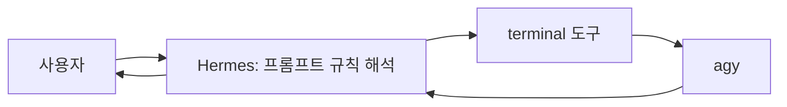
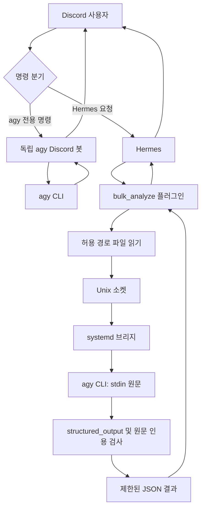

# 구조와 설계 판단

## 초기 구조

사용자는 Hermes가 요청 전달과 결과 중계에 반복 개입하며 데이터를 변형한다고 관찰했습니다. 이 경험은 구조 변경의 동기입니다. 모든 모델·모든 중계에서 변형이 필연적이라는 실험 결과는 아닙니다.

## 독립 봇과 분석 브리지의 공존

prefix guard는 agy 전용 명령에 Hermes가 중복 반응하는 것을 줄이는 코드 경로입니다. 두 봇의 대화 상태를 자동으로 공유하거나 모든 응답을 통합하는 기능은 아닙니다.

| 책임 | 담당 | 한계 |
|---|---|---|
| 호출 여부, 모델 alias, 질문, 파일 선택 | Hermes | 잘못된 질문·파일 선택 가능 |
| 파일 읽기와 경로 제한 | Python 플러그인 | 허용 파일 안의 비밀 내용을 판별하지 않음 |
| 원문 정규화·줄 번호 부여·stdin 전달 | 브리지 코드 | 모델이 원문을 올바르게 이해하는지는 별개 |
| 분석과 주장 생성 | agy 모델 | 누락·해석 오류 가능 |
| 타입·상태·한도·원문 인용 일치 | 브리지 코드 | 의미적 타당성과 완전성 승인 아님 |
| 사용자에게 최종 설명 | Hermes | 검증 결과를 재서술하며 바꿀 수 있음; 비교 시험 예정 |

## 주요 결정

1. **원문을 코드가 읽어 전달한다.** agy에게 파일을 찾아 읽으라고 맡겼을 때 외부 도구·명령·위임 경로가 개입했다. 원문 스냅샷과 줄 번호를 제공해 전달 경로를 단순화했다.
2. **소켓은 로컬 Unix 소켓을 사용한다.** 별도 공개 분석 HTTP 포트를 열지 않고 기존 컨테이너 mount와 전용 소켓 디렉터리를 사용했다.
3. **자유 텍스트에서 JSON을 추측하지 않는다.** 최종 `result.structured_output`과 정확한 인용을 검증한다.
4. **초과·빈 결과·잘못된 인용은 실패다.** 출력 일부를 잘라 정상 결과처럼 보내거나 잘못된 evidence만 몰래 제거하지 않는다.
5. **현재 설치본의 실행 계약을 확인한다.** 등록 함수에 맞는 코드라도 도구 실행기의 반환 형식과 다를 수 있었다.

## 당시 구현의 제한

| 항목 | 제한 |
|---|---|
| 모델 alias | flash / pro |
| 파일 | 최대 12개, 내용 합계 2 MiB |
| 요청 JSON | 4 MiB |
| 질문 | 최대 8,000자 |
| stdout / stderr | 2 MiB / 256 KiB |
| 반환 JSON | 32 KiB |
| 브리지 동시 실행 | 1개, 초과 BUSY |
| CLI / wrapper 제한 | 기본 600초 / 630초 |
| 원본 결과 보존 | 기존 운영 정책 7일 |

이는 분석 성공을 보장하는 입력 크기가 아닙니다. 독립 봇의 동시성 제한과 브리지 제한은 공유되지 않습니다. 출력 2 MiB 제한은 프로세스 전체 메모리 제한도 아닙니다.

systemd 제한과 전용 디렉터리 권한을 사용하지만, 인증 경로와 네트워크는 허용돼 있습니다. 같은 실행 계정 UID를 쓰는 프로세스 간 완전한 격리를 주장하지 않습니다. 이벤트를 관측한 뒤 중단하는 live guard도 도구 실행 전 권한 차단과 다릅니다.
