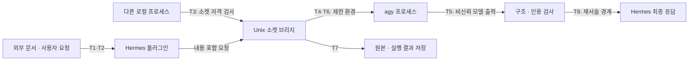

# 위협 모델: 분석 위임 경로의 경계

범위는 `bulk_analyze` 플러그인 → Unix 소켓 브리지 → agy → 결과 반환이다. 독립 Discord 봇·Discord 플랫폼 전체·호스트 관리자·외부 모델 제공자를 모두 방어하는 시스템을 설계했다는 뜻은 아니다. 기준은 포함된 소스와 2026-10-08 실행 기록이다.

## 보호 대상과 전제

- **보호 대상:** 허용 폴더 밖의 파일, 기존 봇의 인증 파일, 분석 원문과 결과의 무결성·기밀성, 프로세스·저장 공간의 가용성, 사용자가 받는 답변의 근거.
- **신뢰하는 관리 영역:** 호스트 root, 서비스·플러그인 코드 및 설정을 관리하는 운영자, 올바른 mount·UID 배치.
- **신뢰하지 않는 입력:** 문서 내용, 모델 응답, 잘못되거나 악의적인 경로·프레임, 허용되지 않은 로컬 접속자.
- **유의할 주체:** 허용 UID의 프로세스와 agy 프로세스는 전체적으로 무해하다고 보장되지 않는다. 인증 디렉터리와 네트워크가 열려 있고, 같은 UID 프로세스 간 완전한 격리는 구현하지 않았다.

## 신뢰 경계

## 위협·통제·남는 위험

| ID / 위협과 공격 능력 | 현재 통제·코드 위치 | 남는 위험 | 증거 수준 |
|---|---|---|---|
| T1. 문서에 지시를 삽입해 모델의 분석·도구 사용을 유도 | 원문을 코드로 전달, `bridge_core.py::prompt`, `LiveOutputGuard`가 알려진 도구·오류 이벤트 감지 | 직접 전달은 인젝션 무력화가 아니다. 감지 전 동작·미인식 이벤트·허용 네트워크를 통한 유출 가능성을 배제하지 못함 | 이벤트 감지 fake/오프라인 시험 및 157KB 실행의 도구 단계 관측. 악성 문서 E2E 방어 시험은 미실시 |
| T2. 경로 우회·심볼릭 링크·하드링크로 허용 폴더 밖 파일 읽기 | `safe_files.py::read_sources`: 부분 경로 거절, dir_fd 기반 컴포넌트별 open, O_NOFOLLOW, 일반 파일·st_nlink 검사, 크기 제한 | 읽을 수 있는 허용 파일 자체에 비밀이 있으면 내용 검열하지 않음. 허용 UID 클라이언트는 플러그인을 우회해 inline 내용을 보낼 수도 있음 | `test_path_boundaries`에 symlink/디렉터리 symlink/hardlink/우회 사례. 운영 Discord는 `..` 거절만 확인 |
| T2b. 읽는 도중 같은 파일 수정·이름 교체 | 열린 fd에서 읽고 전후 size·mtime_ns·ctime_ns 비교 | 경로 이름 교체와 열린 inode 수정은 다름. 모든 경쟁 조건을 방지하는 원자적 스냅샷이 아님 | 구현 확인. 동시 변경의 별도 적대적 회귀 시험은 없음 |
| T3. 비허용 로컬 UID가 브리지 실행 요청 | `Bridge.handle`: SO_PEERCRED의 UID allowlist, 파일시스템 소켓·디렉터리 권한 | 허용 UID 내부의 사용자·세션별 인증은 없음. UID를 바꿀 수 있는 권한이나 호스트 root를 막는 보안 경계가 아님 | peer 거절 fake 시험, 설치 소켓 연결 기록. container-root 공격 전체를 시험한 것은 아님 |
| T4. agy 프로세스가 기존 봇 경로를 읽거나 임의 위치에 쓰기 | [유닛 예시](../examples/agy-bridge.service.example): InaccessiblePaths, ProtectSystem=strict, ReadWritePaths, NoNewPrivileges | ProtectSystem은 읽기 차단이 아님. 제외한 인증 경로·네트워크는 남음. 같은 UID·이미 가진 fd·다른 노출 경로에 대한 완전한 차단 주장 없음 | 기존 제한 환경에서 봇 경로 거절과 실제 호출 기록. 이번 일반화 예시는 새 Linux 배포 미검증 |
| T5. 잘못된 타입·인용·결과를 성공으로 위장 | `adjudicate`, `validate_structured`, `make_reply`: 최종 결과·상태·schema·파일/줄/인용 일치, 크기 제한 | 인용이 실제 주장을 지지하는지·누락이 없는지는 별도 의미 검토 | Validation 시험, 16KB 실제 인용 기록. [정의](04-validation.md#verification-boundaries) 참조 |
| T6. 출력 폭주·무한 대기·연결 폭주로 가용성 저하 | stdout/stderr cap, CLI/wrapper timeout, 프로세스 그룹 종료, cleanup 5초, 연결 수·읽기 시간·동시 실행 1개 제한; 유닛 MemoryMax/TasksMax | 토큰 비용 hard cap 없음. 독립 봇과 공통 쿼터 아님. 그룹을 벗어난 자식·허용 UID의 반복 요청을 모두 해결하지 않음 | fake 출력·취소·timeout·BUSY·cleanup 시험. 지속 부하·비용 한도 시험 미실시 |
| T7. 저장 원문·결과 노출 또는 파일 덮어쓰기 | 결과 디렉터리 0700, 파일 O_EXCL/O_NOFOLLOW·0600, 보존 정리·저장량 사전 검사 | 같은 UID·root의 접근, 백업·로그 유출, 파일시스템 hard quota는 별도 문제. 원문은 실제 모델 제공자에 전송됨 | 저장 코드·운영 보존 정책 기록. 전체 호스트 감사는 아님 |
| T8. 검증 후 Hermes가 인용·의미를 바꿈 | 구조화된 도구 결과와 출처를 제공 | 최종 메시지까지 직접 인용 불변을 강제하지 않음 | [정상 문서 비교 시험](05-next-validation.md) 계획, 아직 실행하지 않음 |
| T9. agy CLI 업데이트로 출력 형식·종료 코드·권한 처리 방식이 바뀌어 감지·판정이 조용히 어긋남 | `adjudicate`·`LiveOutputGuard`가 당시 이벤트 형식 기준으로 실패 처리; 알 수 없는 형식은 성공으로 승격하지 않음 | 자동 업데이트 차단·버전 고정은 이 저장소에 구현하지 않음. 새 이벤트 이름의 도구 단계는 감지하지 못할 수 있음 | 당시 CLI 1.3.1 기록만 있음. 업데이트 후 회귀 절차(버전 확인 → fake 회귀 → 작은 실제 호출 1회)는 계획 |

## 중요한 경계 해석

플러그인은 파일 경로를 받아 내용을 읽는다. 반면 소켓 서버는 **내용이 이미 포함된 요청**을 받는다. 서버가 클라이언트의 파일 읽기 과정을 인증하는 것은 아니다. 허용 UID의 클라이언트가 임의 내용을 전송할 수 있다는 점을 위협 모델에 포함한다.

SO_PEERCRED는 연결한 프로세스의 자격 정보를 확인하는 근거이며, 애플리케이션 사용자의 의도나 원문 신뢰성을 인증하지 않는다. Linux pathname 소켓 권한과 함께 사용한다. [Linux unix(7)](https://man7.org/linux/man-pages/man7/unix.7.html)

O_NOFOLLOW는 한 번의 open에서 마지막 컴포넌트를 대상으로 하므로 이 코드는 각 디렉터리 컴포넌트를 별도로 연다. 열린 fd의 파일과 나중에 같은 경로 이름이 가리키는 파일은 달라질 수 있다. [Linux open(2)](https://man7.org/linux/man-pages/man2/open.2.html)

## 우선 남은 검증

1. 정상 문서에서 브리지 결과와 최종 Discord 답변을 비교.
2. 문서 속 인젝션 미끼를 별도 통제 시험으로 실행하고 감지 여부와 부작용을 각각 기록.
3. 경쟁 파일 변경, 장기 부하, UID 변경 권한을 포함한 위협은 별도 설계·시험 대상으로 남김.
4. agy CLI 버전을 기록하고, 변경 시 fake 회귀와 작은 실제 호출 1회로 판정 로직을 다시 확인(T9).

이 목록은 추가 시험 계획이다. 코드에 통제가 존재한다는 사실을 적대적 환경 전체에 대한 효과 입증으로 바꾸지 않는다. 시험별 실제 실행 범위는 [검증 현황](04-validation.md)에서 확인한다.
